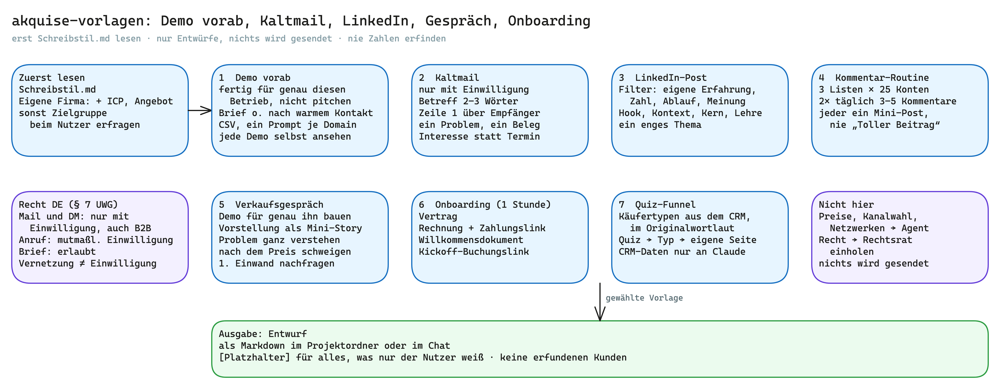

# akquise-vorlagen

Bauplaene fuer B2B-Akquise und Kundenstart: Demo fuer genau diesen Betrieb als Aufhaenger des Erstkontakts, Kaltmail Zeile fuer Zeile, LinkedIn-Post mit Pruefung, taegliche Kommentar-Routine, Verkaufsgespraech, Onboarding in der ersten Stunde, Quiz-Funnel nach Kaeufertypen. Liefert Entwuerfe, sendet nie selbst.



> Quelle des Diagramms: [`akquise-vorlagen-overview.excalidraw`](akquise-vorlagen-overview.excalidraw)

## Installation

Ordner nach `~/.claude/skills/akquise-vorlagen/` kopieren (Befehle im Abschnitt "Skills" des Haupt-README von [how-i-learned-claude](https://github.com/nyko073006/how-i-learned-claude#installation)). Abhaengigkeit: der Vault-Pfad `vault` in `~/.config/claude-skills/einstellungen.json`; der Skill liest `<VAULT>/00 Kontext/Schreibstil.md`.

## Nutzung

```text
/akquise-vorlagen Erstkontakt mit Demo fuer <Branche>, viele Betriebe
/akquise-vorlagen Kaltmail an <Firma>, Anlass <Event>
/akquise-vorlagen Kunde hat zugesagt, Onboarding
```

## Umfang

- Recht DE: Mail, Direktnachricht, Anruf, Brief nach § 7 UWG
- Demo vorab (Website, Chatbot, Probeanruf, Kurzanalyse), Bauweg je Lead aus CSV und festem Prompt je Domain
- Kaltmail (Aufbau, drei Einstiege)
- LinkedIn-Post (Vier-Kriterien-Pruefung, fuenf Themenarten)
- Kommentar-Routine (3 Listen x 25)
- Verkaufsgespraech (Demo, Vorstellung als Mini-Story, Spiegeln)
- Onboarding erste Stunde
- Quiz-Funnel aus CRM

## Hintergrund

Aus 22 Instagram-Reels (Stand 11/2026), US-gepraegt, auf DE angepasst. Strategie und Preise bleiben bei einem eigenen Finanz-/Steuer-Agenten, falls eingerichtet, sonst beim Nutzer.

## Dateistruktur

```
akquise-vorlagen/
├── SKILL.md
├── README.md
├── akquise-vorlagen-overview.excalidraw
└── akquise-vorlagen-overview.png
```
