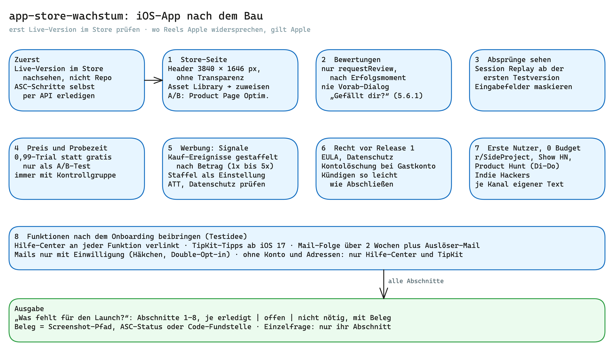

# app-store-wachstum

Handgriffe fuer eine iOS-App nach dem Bau: Store-Seite, Bewertungen, Abbruchanalyse, Probezeitraum, Werbesignale, Rechtstexte, erste Nutzer. Wo Reels Apple widersprachen (Bewertungs-Vorfilter), gilt Apple.



> Quelle des Diagramms: [`app-store-wachstum-overview.excalidraw`](app-store-wachstum-overview.excalidraw)

## Installation

Ordner nach `~/.claude/skills/app-store-wachstum/` kopieren. Keine Abhaengigkeiten.

## Nutzung

```text
/app-store-wachstum was fehlt fuer den Launch von <App>
/app-store-wachstum wie frage ich nach Bewertungen
```

## Umfang

- Header 3840 x 1646 ueber die Asset Library
- Bewertung nur per requestReview nach Erfolgsmoment, kein Gating (5.6.1)
- Session Replay ab Tag 1
- Trial 0,99 statt gratis als A/B-Test
- gestaffelte Kaufsignale
- EULA, Loeschpflicht, Kuendigung
- Launch-Kanaele
- Funktionen nach dem Onboarding beibringen (Testidee): Hilfe-Center an jeder Funktion, TipKit, Mail-Folge ueber zwei Wochen plus Ausloeser-Mail bei ausgelassenem Schritt, nur mit Einwilligung (§ 7 UWG)

## Hintergrund

Aus 6 Instagram-Reels (Stand 10/2026). Header-Mass und Asset Library sowie Review Gating am 30.10.2026 gegen Apple-Hilfe bzw. Sekundaerquellen geprueft.

Abschnitt 8 (1.1.0) kommt aus einem siebten Reel (Hilfe-Center plus Mail-Folge, 90 % weniger Supportmails als Eigenangabe). Geprueft am 24.11.2026: § 7 UWG (Gesetzestext), TipKit, Mail-Relay von "Mit Apple anmelden" und Richtlinie 5.1.1 (Apple-Doku). Gegentest mit Sonnet an einer erfundenen Planer-App ("was fehlt fuer den Launch"):

- Alte Fassung: Hilfe-Center, Mail-Folge und Ausloeser-Mail in 0 von 3 Laeufen.
- Erste neue Fassung: Hilfe-Center, TipKit und Einwilligung 3 von 3, aber die Mail-Folge riet sie 3 von 3 ab, weil der Rechtsabsatz sie verdraengte. Deshalb steht die Einwilligung jetzt als erster Bauschritt da.
- Endfassung: App mit Konto 3 von 3 (Mail-Folge offen, Ausloeser-Mail, Einwilligungs-Haekchen, Relay-Domain); Gegenprobe App ohne Konto 2 von 2 "Mails nicht noetig", ohne Adressabfrage. Nach der Zweitpruefung durch Gemini (Return-Path bei Versanddiensten, `displayFrequency` gilt fuer die ganze App) erneut bestaetigt: mit Konto 2 von 2, ohne Konto 1 von 1.

## Dateistruktur

```
app-store-wachstum/
├── SKILL.md
├── README.md
├── app-store-wachstum-overview.excalidraw
└── app-store-wachstum-overview.png
```
