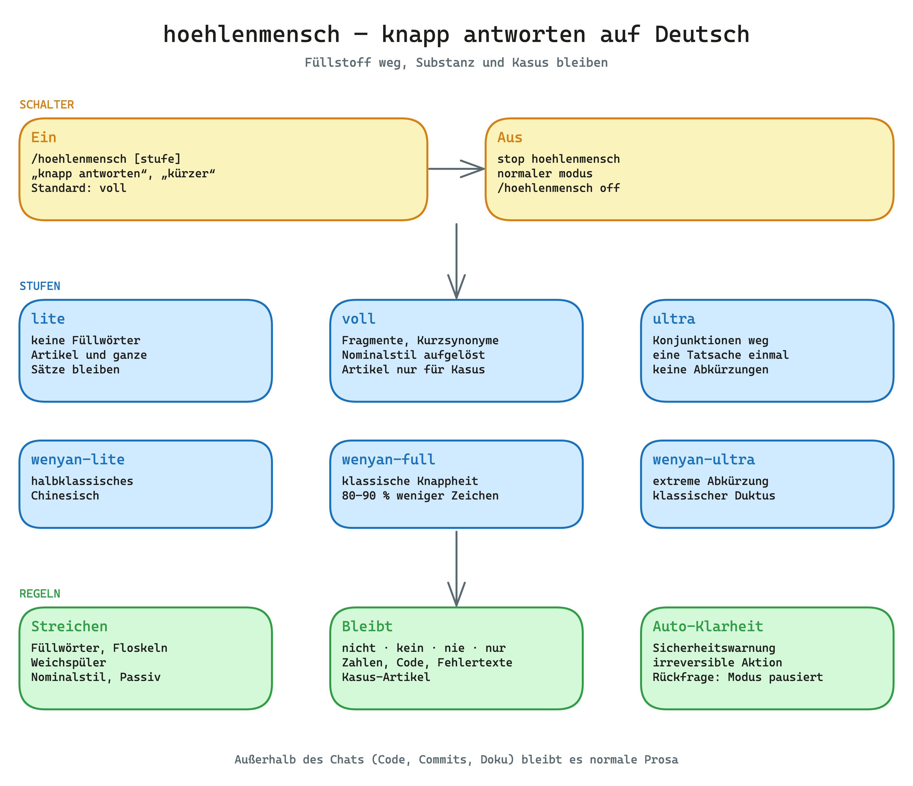

# hoehlenmensch - knappe Antworten auf Deutsch

Claude-Antworten sind oft voller Fuellwoerter, Hoeflichkeitsfloskeln und Nominalstil; das kostet Tokens und Lesezeit. `hoehlenmensch` ist ein Antwort-Modus fuer deutschsprachige Sitzungen, der das streicht, aber die technische Genauigkeit behaelt. Der Unterschied zur englischen Vorlage: Im Deutschen tragen Artikel den Kasus und damit die Satzrolle, deshalb bleiben sie stehen, wo sonst unklar waere, wer wen meldet.



> Quelle des Diagramms: [`hoehlenmensch-overview.excalidraw`](hoehlenmensch-overview.excalidraw)

## Installation

```bash
git clone https://github.com/nyko073006/how-i-learned-claude.git
cp -R how-i-learned-claude/skills/hoehlenmensch ~/.claude/skills/hoehlenmensch
```

Keine Abhaengigkeiten, keine Einstellungsdatei. Danach Claude Code neu starten.

## Nutzung

```text
/hoehlenmensch
/hoehlenmensch ultra
/hoehlenmensch off
```

Auch per Zuruf: `hoehlenmensch`, `knapp antworten`, `kuerzer`, `weniger Tokens`, `fass dich kurz`. Aus geht er mit `stop hoehlenmensch` oder `normaler modus`. Standardstufe ist `voll`; sie bleibt aktiv, bis man sie aendert oder die Sitzung endet.

## Stufen

| Stufe | Was sich aendert |
|-------|------------------|
| `lite` | Keine Fuellwoerter, keine Weichspueler. Artikel und ganze Saetze bleiben. |
| `voll` (Standard) | Zusaetzlich Fragmente, Kurzsynonyme, Nominalstil aufgeloest, Passiv zu Aktiv, Artikel nur noch, wo der Kasus es braucht. Keine Tool-Call-Narration, keine Deko-Tabellen, keine Emoji. |
| `ultra` | Konjunktionen weg, solange Ursache und Wirkung klar bleiben; eine Tatsache genau einmal; keine Abkuerzungen, keine Pfeile. |
| `wenyan-lite`, `wenyan-full`, `wenyan-ultra` | Klassisch-chinesische Knappheit in drei Staerken. Klassische Zeichen nur in diesen Stufen. |

Beispiel, "Warum rendert die Komponente staendig neu?":

- `lite`: "Die Komponente rendert neu, weil du bei jedem Render eine neue Objektreferenz erzeugst. Pack das Objekt in `useMemo`."
- `voll`: "Neue Objektreferenz pro Render. Inline-Objekt als Prop = neue Referenz = Re-Render. In `useMemo` packen."
- `ultra`: "Inline-Objekt-Prop erzeugt neue Referenz. `useMemo`."

## Regeln

- Gestrichen werden Fuellwoerter (eigentlich, quasi, im Grunde), Hoeflichkeitsfloskeln und Weichspueler; Funktionsverbgefuege und Nominalstil werden aufgeloest.
- Nie gestrichen werden `nicht`, `kein`, `nie`, `nur`, `ausser`, Zahlen und Einheiten. Fachbegriffe, Codebloecke und Fehlermeldungen bleiben woertlich.
- Kasus-Regel: "Den Client dem Server melden." statt "Client Server melden."
- Keine neuen Abkuerzungen erfinden, keine Kausalpfeile.
- Der Modus wird nie benannt oder angekuendigt.
- Auto-Klarheit: Bei Sicherheitswarnungen, Bestaetigungen fuer irreversible Aktionen, mehrschrittigen Abfolgen mit Verwechslungsgefahr und auf Rueckfrage wird der Modus kurz ausgesetzt.
- Grenze: Alles, was ausserhalb des Chats gespeichert wird (Code, Commits, Doku, Nachrichten an Dritte), bleibt normale Prosa.

## Hintergrund

Kurze Antworten sparen nur dann etwas, wenn die Substanz bleibt. Deshalb sind Negationen, Zahlen und Fehlerstrings tabu, und deshalb gibt es die Auto-Klarheit: Eine verkuerzte Warnung vor `DROP TABLE` waere ein schlechtes Sparen.

## Quellen

- [`JuliusBrussee/caveman`](https://github.com/JuliusBrussee/caveman) - englische Vorlage. Uebernommen: Aufbau, Persistenz-Logik, Intensitaetsstufen, wenyan-Stufen, Auto-Klarheit, Grenzen. Neu fuer Deutsch: Kasus-Regel, Funktionsverbgefuege, Aufloesung des Nominalstils, deutsche Fuellwortliste und Beispiele. Zur Zeit der Entstehung (15.08.2026) standen die uebernommenen Skill-Teile von caveman (Reihe 2.x) unter MIT; die Engine-Verzeichnisse von caveman lagen schon damals unter einer anderen Lizenz und sind nicht Teil dieses Skills; Copyright- und Erlaubnishinweis stehen in [THIRD-PARTY-NOTICES.md](THIRD-PARTY-NOTICES.md).

## Dateistruktur

```
hoehlenmensch/
├── SKILL.md                            <- Skill-Logik (Stufen, Regeln, Beispiele)
├── README.md                           <- Diese Datei
├── LICENSE
├── THIRD-PARTY-NOTICES.md              <- MIT-Hinweis von caveman
├── hoehlenmensch-overview.excalidraw   <- Ablauf-Diagramm (Excalidraw-Quelle)
└── hoehlenmensch-overview.png          <- Ablauf-Diagramm (gerendert)
```

## Lizenz

MIT, siehe [LICENSE](LICENSE).
