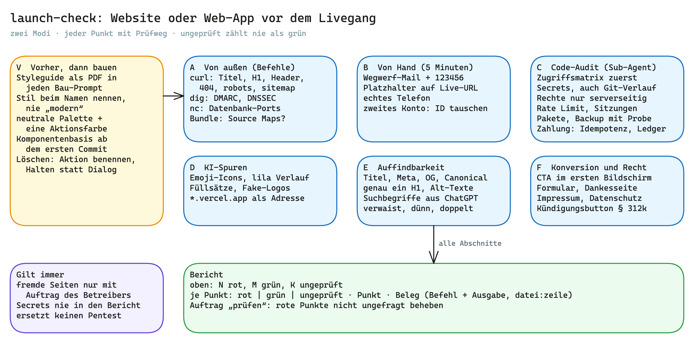

# launch-check

Prueft eine KI-gebaute Website oder Web-App vor dem Livegang. Fuenf Creator lieferten je eine eigene 20-Punkte-Liste; dieser Skill fuehrt sie zusammen und gibt jedem Punkt einen Pruefweg (Befehl, Handgriff oder Code-Fundstelle), damit am Ende eine Rot/Gruen-Liste mit Beleg steht statt eines Bauchgefuehls.



> Quelle des Diagramms: [`launch-check-overview.excalidraw`](launch-check-overview.excalidraw)

## Installation

Ordner nach `~/.claude/skills/launch-check/` kopieren (Befehle im Abschnitt "Skills" des Haupt-README von [how-i-learned-claude](https://github.com/nyko073006/how-i-learned-claude#installation)). Abhaengigkeiten: `curl`, `dig` und `nc` fuer die Pruefungen von aussen, `python3` (nur Standardbibliothek) fuer `scripts/seitenstruktur.py`.

## Nutzung

```text
/launch-check https://meine-seite.de
/launch-check vorher   (Design-Vorgaben fuer ein neues Projekt)
```

## Umfang

- **Vorher:** Styleguide-PDF, Stil beim Namen, eine Aktionsfarbe, Komponentenbasis, Muster fuer Loeschen.
- **Pruefen:** A von aussen (curl, dig, nc), B von Hand (Wegwerf-Mail, zweites Konto), C Code-Audit (Secrets auch im Git-Verlauf, Rechte serverseitig, Mandantentrennung mit Beleg, erfundene Pakete, Backup mit Rueckspielprobe, Zahlungen, Uploads), D KI-Spuren, E Auffindbarkeit je Seite und ueber alle Seiten (verwaiste Seiten, Keyword-Kannibalisierung, duenne Seiten per `scripts/seitenstruktur.py`), F Konversion und Recht (DE).

## Hintergrund

Aus rund 20 Instagram-Reels (Stand 10/2026), gebuendelt im Sammelmodus von reel-ingest. Befehlsblock am 30.10.2026 gegen example.com getestet; H1-Zaehlung mit Gegentest (zwei H1 in einer Zeile).

Version 1.2.0 (24.11.2026) prueft eine 18-Punkte-Sicherheitsliste aus einem weiteren Reel gegen den Skill. Die Pruefwege stammen aus der Supabase- und OWASP-Doku, nicht aus dem Reel. Gegentest mit Sonnet an zwei Test-Repos (Next.js plus Supabase, mehrere Mandanten, eingebaute Luecken), je drei Laeufe pro Fassung:

- Backup als Pruefpunkt: alt 1 von 6 (nur nebenbei beim Loeschkonzept, ohne Rueckspielprobe), neu 6 von 6 (Free Plan rot, Pro ohne Rueckspielprobe ungeprueft).
- Mandantentrennung ohne Test: alt 3 von 3 gruen allein wegen `enable row level security`, neu 3 von 3 ungeprueft oder rot.
- Erfundenes npm-Paket: alt 2 von 3 rot, neu 3 von 3 rot mit 404-Beleg aus `npm view`.
- Nicht aufgenommen, weil schon die alte Fassung 3 von 3 fand: Tabelle ohne RLS, Mass Assignment (auch direkt per REST), View ohne `security_invoker`, `security definer`-Funktion, `node-serialize`, Shell-Befehl mit Nutzerwert, Admin-Seite ohne Rollenpruefung.

Endfassung danach mit vier weiteren Laeufen bestaetigt.

Version 1.3.0 (24.11.2026) ergaenzt drei Punkte aus einer 23-Punkte-SEO-Liste (Instagram-Karussell), die der Skill nicht pruefte: verwaiste Seiten, Keyword-Kannibalisierung und duenne Seiten. Die Pruefwege stammen aus der Google-Search-Central-Doku, nicht aus dem Beitrag. Gegentest mit Sonnet an einer statischen Testseite (11 Seiten, drei eingebaute Fehler, kurze Rechts- und Kontaktseiten als Koeder fuer Fehlalarme), je drei Laeufe pro Fassung:

- Verwaiste Seite (in der Sitemap, nirgends verlinkt): alt 0 von 3 rot (einmal als Randnotiz "vielleicht Absicht"), neu 3 von 3 rot.
- Zwei Seiten zum selben Suchbegriff, verschieden formuliert: alt 0 von 3, neu 3 von 3 rot (Aehnlichkeit 0,54 gegen 0,37 beim naechsten Paar).
- Leistungsseite mit zwei Saetzen: alt 0 von 3 (nur die kurze Meta-Description bemaengelt), neu 3 von 3 rot.
- Fehlalarme: Impressum, Kontakt und Uebersichtsseite in keinem Lauf rot, Kosten-Ratgeber nie als Kannibalisierung.
- Gegenprobe an der bereinigten Seite, zwei Laeufe: verwaist und Kannibalisierung 2 von 2 gruen.

## Dateistruktur

```
launch-check/
├── SKILL.md
├── README.md
├── scripts/
│   └── seitenstruktur.py
├── launch-check-overview.excalidraw
└── launch-check-overview.png
```
