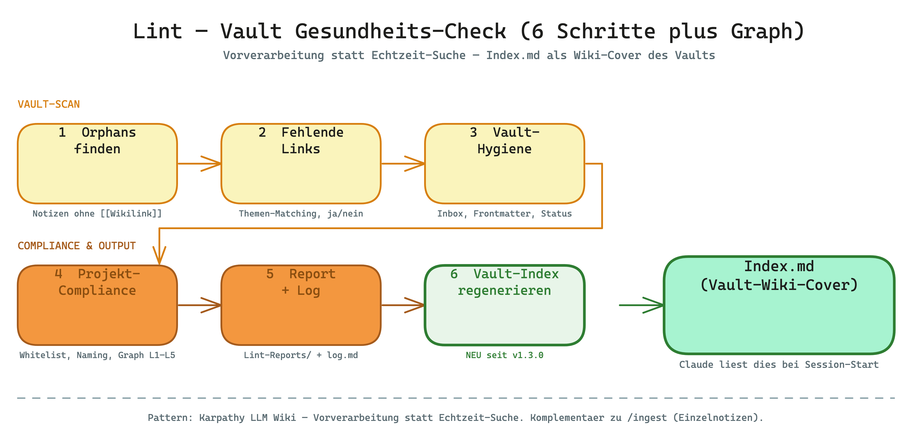

# Lint Skill — Vault Gesundheits-Check

Woechentlicher Vault-Check fuer einen Obsidian-Vault. Findet verwaiste Notizen, fehlende Verknuepfungen, Vault-Hygiene-Probleme, Projekt-Compliance-Drift — und regeneriert seit v1.3.0 das **Wiki-Cover** (`Index.md`) im Vault-Root.

**Der Kern:** Vorverarbeitung statt Echtzeit-Suche. Statt das Vault bei jeder Session neu zu durchsuchen, liest Claude die `Index.md` und hat sofort den Ueberblick (Karpathy LLM Wiki Pattern). Komplementaer zum [`ingest`](../ingest/) Skill: Ingest verarbeitet einzelne Notizen, Lint prueft das ganze Vault systematisch.



> Quelle des Diagramms: [`lint-overview.excalidraw`](lint-overview.excalidraw)

## Installation

Wie im Abschnitt "Skills" des Haupt-README von [how-i-learned-claude](https://github.com/nyko073006/how-i-learned-claude#installation) beschrieben; einen vorhandenen Ordner nicht ueberschreiben:

```bash
git clone https://github.com/nyko073006/how-i-learned-claude.git
mkdir -p ~/.claude/skills
test -e ~/.claude/skills/lint && echo "lint existiert schon, nichts kopiert" || cp -R how-i-learned-claude/skills/lint ~/.claude/skills/
```

Voraussetzung fuer das Pruefskript: Python 3 (nur Standardbibliothek, getestet mit 3.13).

Einstellungen stehen in `~/.config/claude-skills/einstellungen.json` (Pfad per Env
`CLAUDE_SKILLS_EINSTELLUNGEN` ueberschreibbar):

```json
{"vault": "~/Pfad/zu/deinem/Vault", "dienst_ordner": "02 Projekte/Dienst"}
```

- `vault`: Pfad des Vaults. Ohne `--vault` und ohne diesen Schluessel bricht das Skript mit
  Klartext und Exit 2 ab.
- `dienst_ordner` (optional, Vorgabe leer): Vault-relativer Ordner fuer dienstliche Notizen.
  Leer heisst: die Dienst-Ausnahme in L1 und die Pruefung L5 entfallen.

Pruefen ob es funktioniert:

```bash
python3 -I -m unittest discover -s ~/.claude/skills/lint/scripts
```

```
/lint
```

## Nutzung

| Aufruf | Verhalten |
|--------|-----------|
| `/lint` | Vollstaendiger Vault-Check (alle 6 Schritte) |
| `/lint orphans` | Nur verwaiste Notizen suchen (Schritt 1) |
| `/lint inbox` | Nur Inbox pruefen (Teil von Schritt 3) |
| `/lint projekte` | Nur Projekt-Compliance (Schritt 4) |
| `/lint index` | Nur Vault-Index regenerieren (Schritt 6) |

Weitere Ausloeser: `lint`, `vault check`, `pruefe das vault`, `gesundheitscheck`, `verwaiste notizen`, `orphans`, `projekt-compliance`, `projekt-check`.

## Pruefskript (seit v1.5.0)

`scripts/vault_lint.py` macht die Zaehlarbeit der Schritte 1, 3 und 4 und sammelt die Daten fuer den Index. Es liest nur und aendert nichts im Vault. Vorher schrieb Claude dafuer bei jedem Lauf ein neues Hilfsskript; das kostete Tokens und brachte jedes Mal eigene Fehler mit (am 15.10.2026: Namen wie „Build 1.4.0“ galten als Datei mit Endung `.0`, der eigene Report zaehlte als eingehender Link).

```bash
python3 -I ~/.claude/skills/lint/scripts/vault_lint.py --json /tmp/lint.json
python3 -I ~/.claude/skills/lint/scripts/vault_lint.py --teil projekte
python3 -I ~/.claude/skills/lint/scripts/vault_lint.py --vault ~/anderes-vault --heute 2026-10-15
```

| Option | Bedeutung |
|--------|-----------|
| `--json DATEI` | alle Funde mit Pfad und Zeile, dazu `counts` und `index` |
| `--teil` | `alles` (Vorgabe), `orphans`, `inbox`, `projekte`, `index` |
| `--vault PFAD` | Vorgabe: Einstellung `vault`; fehlt beides, Exit 2 mit Klartext |
| `--heute JJJJ-MM-TT` | Stichtag fuer Altersangaben (Hub-Aktualitaet, Pre-Backlog) |

- Links loest es wie Obsidian auf: Name, Pfad-Ende, Alias, Abschnitt, Block, Einbettung, Markdown-Link (auch ohne Endung), Frontmatter; Gross/Klein egal. Code zaehlt nicht, Codebloecke enden wie in CommonMark nur an einer Zeile ohne Info-String.
- Links aus `Index.md` und `Lint-Reports/` zaehlen nicht als eingehend, weil der Lint beide selbst schreibt.
- Fuer Schritt 2 liefert es je Waise die Stellen, an denen sie erwaehnt, aber nicht verlinkt ist (`mentions`).
- Am 15.10.2026 gegen Obsidians `app.metadataCache` abgeglichen: Waisen (15), Notizzahl (475) und offene Links (18 Notizen) deckungsgleich. Laufzeit damals rund 0,25 s fuer 641 Notizen (Stand 16.11.2026: rund 2,3 s fuer 1586 Notizen mit Graph-Pruefungen).
- Tests in `scripts/test_vault_lint.py`: jeder baut sich einen Wegwerf-Vault, jede Graph-Pruefung hat einen Fehler- und einen sauberen Testvault unter `scripts/testdaten/`.

## Was der Skill tut (6 Schritte plus 4b)

### 1. Verwaiste Notizen finden

Das Pruefskript liest alle `*.md` im Vault und prueft fuer jede Notiz, ob eine andere sie verlinkt. Daily Notes, `00 Kontext/`, `memory/`, `06 Archiv/`, `CLAUDE.md`, `AGENTS.md`, `log.md`, `Index.md`, Synthese-Start-Dateien und Maschinen-geschriebene Dateien (`Briefings/`, `* Tasks.md` in der Vault-Wurzel) sind explizit ausgenommen.

### 2. Fehlende Verknuepfungen vorschlagen

Themen-Matching zwischen Notizen. Pro Vorschlag wird einzeln gefragt — kein Bulk-Apply.

### 3. Vault-Hygiene pruefen

- Inbox-Stand (Warnung > 5)
- Abgeschlossene Projekte als Archiv-Kandidaten
- Notizen ohne Frontmatter / Tags (ohne Maschinen-geschriebene Dateien)
- Synthese-Seiten pro Ressourcen-Ordner

### 4. Projekt-Compliance pruefen (seit v1.2.0)

Iteration ueber `02 Projekte/*/` gegen die Governance aus `00 Kontext/Projekt-Struktur.md`:

- Whitelist Projektwurzel (nur PMO HUB, Governance, Financials, Fehlerlog; `Fehlerlog.md` ist erlaubt, aber keine Pflichtdatei)
- `README.md` im Projektwurzel verboten
- Pflicht-Dateien existieren (`* - PMO HUB.md`, `Projekt-Governance.md`)
- Naming-Konvention `* - PMO HUB.md`
- Markdown in `*/Research/assets/` (sollte ein Level hoeher)
- Kaputte Wikilinks im PMO HUB
- Decisions-Frontmatter-Konsistenz
- Pre-Backlog-Items aelter als 30 Tage

### 4b. Knowledge Graph pruefen (seit v1.6.0)

Entitaeten sind Notizen mit `type: person|firma|projekt|werkzeug` im Frontmatter (Spec `03 Bereiche/Claude Code/2026-11-15 Spec Knowledge Graph.md` im Vault). Fuenf Pruefungen, je mit Fehler- und sauberem Testvault unter `scripts/testdaten/`:

- L1 Unverlinkte Erwaehnungen: Notiz nennt eine Entitaet, verlinkt sie aber nirgends (Personen in Notizen aus dem Dienstordner `dienst_ordner` zaehlen nicht)
- L2 Entitaeten ohne eingehenden Link
- L3 Fehlende Rueckverweise zwischen Entitaeten
- L4 Widersprueche: Beziehung passt nicht zum Typ, Ziel fehlt, Wert ohne Link, doppelter Name
- L5 Grenze Dienstliches: Person mit Link in oder aus dem Dienstordner (ohne `dienst_ordner` keine Funde)

```bash
python3 -I ~/.claude/skills/lint/scripts/vault_lint.py --teil graph
```

### 5. Report erstellen und Log aktualisieren

Markdown-Report in `Lint-Reports/YYYY-MM-DD Vault Lint Report.md` (Vault-Wurzel, seit 1.4.0; vorher `01 Inbox/`, wo er als unsortierte Notiz zaehlte) mit allen Findings, plus append-only Eintrag in `log.md`. Korrekturen werden einzeln angeboten, nichts wird automatisch geaendert.

### 6. Vault-Index regenerieren (seit v1.3.0)

Pre-kompilierte `Index.md` im Vault-Root als **Wiki-Cover**:

- Aktive Projekte (mit Status, Phase, letzte Aktualisierung)
- Bereiche (`03 Bereiche/`)
- Synthese-Seiten (`04 Ressourcen/`)
- Kontext-Dokumente (`00 Kontext/`)
- Letzte 5 Daily Notes
- Letzte 3 Lint-Reports
- Vault-Statistik

Statische Wikilinks (kein Dataview), bei jedem Lauf vollstaendig ueberschrieben — der Index ist immer ein Snapshot.

## Hintergrund: Warum dieser Skill?

### Das Problem

Ein Vault (PARA-Struktur) waechst organisch. Ohne regelmaessigen Check entstehen:

- Verwaiste Notizen ohne eingehende Links (Compound-Effekt verloren)
- Projekte die der Governance-Konvention nicht mehr folgen (Drift)
- Volle Inbox die nie aufgeraeumt wird
- Claude muss bei jeder Session das ganze Vault neu durchsuchen, weil es keinen Einstiegspunkt gibt

### Die Loesung

`lint` macht zwei Dinge:

1. **Findet Drift** — Konvention-Verstoesse werden sichtbar bevor sie sich aufstauen
2. **Erzeugt einen Einstiegspunkt fuer Claude** — `Index.md` im Vault-Root als vorkompiliertes Wiki-Cover

### Warum keine Dataview-Queries im Index?

Obsidian rendert Dataview im Editor, aber Claude liest die Markdown-Quelle. Dataview-Queries waeren fuer Claude leere Code-Bloecke. Statische Wikilinks bleiben lesbar — und bei jedem Lint-Lauf aktuell.

### Performance-Argument

| Ohne Index | Mit Index |
|-----------|-----------|
| Claude durchsucht das ganze Vault | Claude liest eine Seite |
| Tokens pro Session: hoch | Tokens pro Session: niedrig |
| Findet aktive Projekte per Glob | Hat alle aktiven Projekte sofort |
| Kein zentraler Einstieg | Vault-Cover als Karte |

## Regeln

1. **IMMER fragen** bevor Notizen veraendert werden
2. **NIE loeschen** — bestehende Inhalte werden nur ergaenzt
3. **07 Anhaenge/ komplett ignorieren** — keine Bilder/PDFs durchsuchen
4. **Daily Notes sind keine Orphans** — sie stehen fuer sich
5. **Report ist sachlich** — keine Wertungen, nur Fakten und Vorschlaege
6. **Log ist append-only** — nie bestehende Eintraege aendern
7. **Index.md ist atomar** — komplett ueberschreiben, keine inkrementellen Edits
8. **Sprache: Deutsch** — alle Ausgaben auf Deutsch

## Dateistruktur

```
lint/
├── SKILL.md                  <- Skill-Logik DE (Workflow, Regeln)
├── SKILL.en.md               <- Skill-Logik EN (Kurzfassung)
├── README.md                 <- Diese Datei
├── lint-overview.excalidraw  <- Workflow-Diagramm (Excalidraw-Quelle)
├── lint-overview.png         <- Workflow-Diagramm (gerendert)
└── scripts/
    ├── vault_lint.py         <- Pruefskript (Schritte 1, 3, 4, 4b und Index-Daten)
    ├── test_vault_lint.py    <- Tests mit Wegwerf-Vaults
    └── testdaten/L1..L5/     <- je ein Fehler- und ein sauberer Testvault (fehler/, sauber/)
```

## Quellen

- [Karpathy LLM Wiki Gist](https://gist.github.com/karpathy/442a6bf555914893e9891c11519de94f) — das Pattern hinter `Index.md`
- Komplementaerer Skill: [`ingest`](../ingest/) — verarbeitet einzelne Notizen

## Versionshistorie

| Version | Datum | Aenderungen |
|---------|-------|-------------|
| 1.6.0 | 2026-11-16 | Knowledge Graph: Entitaeten-Register und Pruefungen L1 bis L5 (Schritt 4b, `--teil graph`) mit Testvaults und Mutationstests |
| 1.5.0 | 2026-10-15 | Pruefskript `scripts/vault_lint.py` mit Tests; Links aus Index und Reports zaehlen nicht; Ausnahmen `memory/`, `06 Archiv/`, `AGENTS.md`, `Index.md` festgeschrieben; Hinweise zu Wurzel und Bereichen (3e) |
| 1.4.3 | 2026-10-15 | `Fehlerlog.md` in die Projektstruktur aufgenommen |
| 1.4.2 | 2026-10-11 | Diagramm: Pfeil 3 → 4 laeuft nicht mehr durch die Beschriftungen und endet an Schritt 4 statt ueber Schritt 5 |
| 1.4.1 | 2026-10-11 | Diagramm als PNG gerendert und in die README eingebettet |
| 1.4.0 | 2026-10-11 | Reports nach `Lint-Reports/` (Vault-Wurzel) statt `01 Inbox/`; Index liest die letzten 3 dort |
| 1.3.3 | 2026-10-10 | Ausnahmen fuer Maschinen-geschriebene Dateien (`Briefings/`, `* Tasks.md` in der Vault-Wurzel) bei Orphan- und Frontmatter-Check |
| 1.3.2 | 2026-05-05 | Pfad-Sanitisierung fuer oeffentliches Repo |
| 1.3.1 | 2026-05-02 | README.md + Excalidraw-Diagramm nachgezogen |
| 1.3.0 | 2026-05-02 | Schritt 6: Vault-Index regenerieren — pre-kompilierte `Index.md` als Wiki-Cover |
| 1.2.1 | 2026-04-17 | Englische Doku nachgezogen (SKILL.en.md) |
| 1.2.0 | 2026-04-17 | Projekt-Compliance-Sektion (Schritt 4) |
| 1.1.0 | 2026-04-17 | Frontmatter-Description erweitert |
| 1.0.0 | 2026-04-15 | Initial release: 4-Phasen-Workflow |
