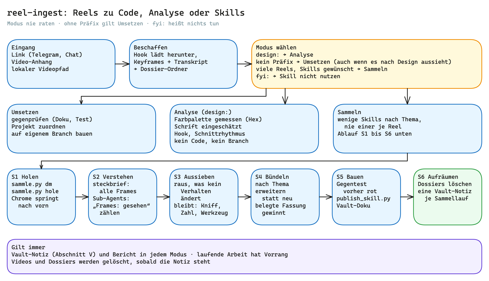

# reel-ingest

Macht aus Reels (Instagram, YouTube Shorts, TikTok) verwertbares Wissen. Ein Reel ist schnell gespeichert und nie wieder angesehen; dieser Skill laedt es, schneidet Keyframes, misst die Farbpalette, transkribiert den Ton und setzt das Gezeigte um, analysiert es oder buendelt viele Reels zu wenigen Skills.



> Quelle des Diagramms: [`reel-ingest-overview.excalidraw`](reel-ingest-overview.excalidraw)

## Installation

Erst den Ordner nach `~/.claude/skills/` kopieren (Befehle im Abschnitt "Skills" des Haupt-README von [how-i-learned-claude](https://github.com/nyko073006/how-i-learned-claude#installation)), dann:

```bash
cd ~/.claude/skills/reel-ingest
python3 -m venv venv
venv/bin/pip install -r requirements.txt
```

Braucht `ffmpeg`/`ffprobe` im Pfad. Fuer den Sammelmodus aus Instagram-DMs zusaetzlich `opencli` mit verbundener Chrome-Erweiterung im Chrome-Profil des Lesekontos; dessen Name steht in `~/.config/claude-skills/einstellungen.json` unter `reel_chrome_profil` (das Konto unter `reel_konto`). Ist `reel_chrome_profil` leer, bricht `sammle.py dm` mit Exit 2 ab. Ist `reel_konto` leer, fragt Claude im Sammelmodus nach dem Konto. Optional: Telegram (Plugin mit Bot), wenn Reels per Telegram kommen und der Bericht dorthin gehen soll.

## Modi

| Eingang | Modus | Ergebnis |
|---|---|---|
| Link ohne Praefix | Umsetzen | Technik gegen echte Doku geprueft, auf Branch `reel/<datum>-<name>` im passenden Projekt gebaut |
| `design:` + Link | Analyse | Palette (Hex mit Anteil), Schrift-Einschaetzung, Hook, Schnittrhythmus; kein Code |
| mehrere Reels, "mach Skills daraus" | Sammeln | wenige Skills nach Thema, bestehende Skills erweitert statt neue je Reel |
| `fyi:` | — | nichts |

## Nutzung

Einzelnes Reel: Link per Telegram an den Bot schicken oder im Chat nennen. Weitergeleitete Videos und lokale Dateien gehen ueber `verarbeite_datei` (siehe SKILL.md, Abschnitt 0).

Sammelmodus:

```bash
cd ~/.claude/skills/reel-ingest && venv/bin/python scripts/sammle.py dm > "$TMPDIR/reel-links.txt"
cd ~/.claude/skills/reel-ingest && venv/bin/python scripts/sammle.py hole $(cat "$TMPDIR/reel-links.txt")
cd ~/.claude/skills/reel-ingest && venv/bin/python scripts/sammle.py steckbrief <ORDNER>
cd ~/.claude/skills/reel-ingest && venv/bin/python scripts/sammle.py aufraeumen <ORDNER>
```

`dm` liest die geteilten Reels aus dem obersten DM-Chat (`--chat NAME` fuer einen anderen), `hole` laedt in niedrigster Qualitaet mit Ton, baut die Dossiers und loescht die Videos, `steckbrief` legt je Dossier Kontaktbogen und Markdown fuer Sub-Agents an, `aufraeumen` loescht die Dossiers nach der Auswertung. Waehrend `dm` springt Chrome immer wieder nach vorn (verdeckte Tabs rendert Chrome nicht); Bild- und Karussell-Posts laedt `hole` ueber gallery-dl (Cookies aus dem Chrome-Profil `reel_chrome_profil` der Einstellungsdatei), jede Folie wird ein Frame.

## Hintergrund

Jedes Reel bekommt eine Vault-Notiz unter `04 Ressourcen/Reel-Analysen/`. Das Reel gilt als Fingerzeig, nicht als Quelle: Was die Doku nicht bestaetigt, wird nicht gebaut. Der Sammelmodus entstand aus einem Reel, das genau das empfiehlt (alles an einen Ort, vergleichen, die beste Fassung behalten, Skills stapeln).

## Dateistruktur

```
reel-ingest/
├── SKILL.md               Anweisung fuer Claude (Modi, Stufen, Vault-Notiz)
├── README.md
├── reel-ingest-overview.excalidraw
├── reel-ingest-overview.png
├── cli.py                 Einstieg fuer den Telegram-Hook
├── config.json            Umfangsbremse, Cookies, Aufbewahrung
├── hooks/reel_guard.sh    Hook: holt Reels mit Link automatisch
├── scripts/sammle.py      Sammelmodus: DM-Links, Download niedrig, Aufraeumen
├── src/                   fetch, frames, palette, transcript, pipeline
├── references/projekte.beispiel.md Vorlage der Projekt-Registry (eigene: ~/.config/claude-skills/reel-ingest-projekte.md)
├── docs/                  Design und Plan (nicht im oeffentlichen Repo)
└── tests/
```
