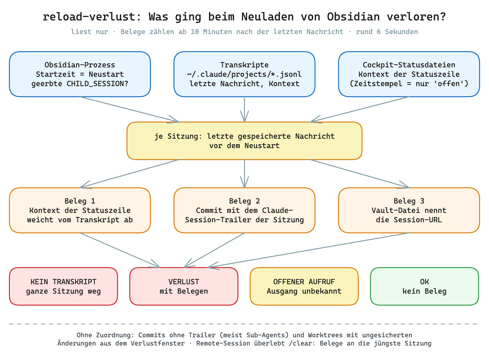

# reload-verlust — Was ging beim Neuladen von Obsidian verloren?

Wer Claude Code in Obsidian-Tabs betreibt (Glasscockpit, agentic-os), verliert beim Neuladen des Plugins oder beim Neustart von Obsidian den laufenden Aufruf jedes Tabs. Schlimmer: Wurde Obsidian aus einer Claude-Sitzung heraus gestartet, erbt es `CLAUDE_CODE_CHILD_SESSION=1`, und die Tabs schreiben stundenlang kein Transkript. Ein `--resume` landet dann weit in der Vergangenheit. Dieser Skill findet heraus, welche Sitzungen betroffen sind, belegt es und zeigt, was auf der Platte gesichert ist.



> Quelle des Diagramms: [`reload-verlust-overview.excalidraw`](reload-verlust-overview.excalidraw)

## Installation

Wie im Abschnitt "Skills" des Haupt-README von [how-i-learned-claude](https://github.com/nyko073006/how-i-learned-claude#installation) beschrieben; einen vorhandenen Ordner nicht ueberschreiben:

```bash
git clone https://github.com/nyko073006/how-i-learned-claude.git
mkdir -p ~/.claude/skills
test -e ~/.claude/skills/reload-verlust && echo "reload-verlust existiert schon, nichts kopiert" || cp -R how-i-learned-claude/skills/reload-verlust ~/.claude/skills/
```

Voraussetzung: nur macOS (liest den Obsidian-Prozess per `ps`), Python 3 (nur Standardbibliothek), Git. Optional die Cockpit-Statuszeile (`~/.claude/cockpit/sessions/`): Ohne sie entfaellt die Belegart Kontext-Abweichung, die anderen beiden bleiben. Pruefen:

```bash
python3 -I -m unittest discover -s ~/.claude/skills/reload-verlust/scripts
```

## Nutzung

Im Chat: „was ist beim reload verloren gegangen“, „was hat der Neustart zerschossen“, „wo waren wir“, `/reload-verlust`. Claude laesst das Skript laufen, prueft die Belege nach und antwortet je betroffener Sitzung mit Stand, Gesichertem, Offenem und naechstem Schritt.

Direkt im Terminal:

```bash
python3 -I ~/.claude/skills/reload-verlust/scripts/reload_verlust.py
python3 -I ~/.claude/skills/reload-verlust/scripts/reload_verlust.py --zeit 14:06
python3 -I ~/.claude/skills/reload-verlust/scripts/reload_verlust.py --zeit "2026-10-20 21:30" --stunden 24
```

| Option | Bedeutung |
|--------|-----------|
| `--zeit` | Zeitpunkt des Neuladens, `HH:MM` (heute) oder `JJJJ-MM-TT HH:MM`. Vorgabe: Start des Obsidian-Prozesses. Bei `plugin:reload` laeuft der Prozess weiter, dann angeben. |
| `--stunden` | Rueckblick vor dem Neustart, Vorgabe 12 |
| `--repos` | Ordner mit Git-Repos (eine Ebene tief), mehrfach; Vorgabe `repo_wurzeln` aus `~/.config/claude-skills/einstellungen.json`, sonst `~/Developer` |
| `--projects`, `--cockpit` | Pfade zu Transkripten (`~/.claude/projects`), Cockpit-Statusdateien (`~/.claude/cockpit`) |
| `--vault` | Vault-Pfad; Vorgabe `vault` aus `~/.config/claude-skills/einstellungen.json`. Fehlt beides oder gibt es den Ordner nicht, bricht das Skript mit Exit 2 und Klartext ab. |

## Urteile

| Urteil | Bedeutung |
|--------|-----------|
| `KEIN TRANSKRIPT` | Tab hatte Kontext, es gibt aber keine Transkriptdatei. Ganze Sitzung weg. |
| `VERLUST` | Nach der letzten gespeicherten Nachricht belegt weitergearbeitet. |
| `OFFENER AUFRUF` | Letzter Werkzeugaufruf ohne Ergebnis, Ausgang unbekannt. |
| `OK` | Kein Beleg fuer spaetere Arbeit. |

Belege, jeweils mehr als 10 Minuten nach der letzten gespeicherten Nachricht:

1. Der Kontextstand der Statuszeile (`~/.claude/cockpit/sessions/<id>.json`) weicht vom letzten Stand im Transkript ab.
2. Ein Commit traegt den `Claude-Session`-Trailer der Sitzung.
3. Eine Vault-Datei wurde geaendert und nennt die Session-URL (`chat_url`, Daily-Note-Callout).

Dazu kommt der Abschnitt „Ohne Zuordnung“: Commits ohne Trailer (meist von Sub-Agents) und Worktrees, deren ungesicherte Dateien im Verlustfenster angefasst wurden.

## Hintergrund

Am 21.10.2026 kam nach einem Obsidian-Neustart die Frage „was ist beim letzten reload verloren gegangen?“. Die Pruefung von Hand dauerte rund zehn Werkzeugaufrufe und lieferte zuerst ein falsches Ergebnis. Zwei Fallen stecken jetzt im Skript:

- **Der Zeitstempel der Statusdatei ist kein Lebenszeichen.** Die Statuszeile schreibt mit `refreshInterval: 30` auch im Leerlauf. Eine seit 07:19 stille Sitzung sah deshalb aus wie eine, die bis 09:56 gearbeitet hatte.
- **Die Remote-Session ueberlebt `/clear`.** Zwei Sitzungen im selben Tab teilen sich die `cse_…`-ID. Belege gehoeren der juengsten.

Ausserdem haengt `git status` in iCloud-Ordnern, weil sich dort die ctime staendig aendert. Mit `core.trustctime=false` dauerte der Lauf 6 Sekunden statt 2:10 Minuten.

Ergebnis am 21.10.: fuenf betroffene Sitzungen von 13, jede mit Commit-, Vault- oder Kontext-Beleg, deckungsgleich mit der Pruefung von Hand. Dazu der Fund, dass die Transkripte schon ab 10:15 bis 10:40 fehlten, nicht erst ab 12:32.

## Grenzen

- Reine Gespraeche ohne Commit, ohne Vault-Datei und ohne Statuszeile bleiben unsichtbar.
- Ein wieder geoeffneter Tab ueberschreibt seine Statusdatei. Dann bleiben nur Beleg 2 und 3.
- Commits ohne Trailer ordnet das Skript keiner Sitzung zu.

## Tests

17 Tests in `scripts/test_reload_verlust.py`. Jeder baut sich Wegwerf-Ordner mit Transkripten, Statusdateien, Vault und einem echten Git-Repo. Neun eingebaute Fehler (Mutanten) werden alle rot, darunter „Statusdatei-Zeitstempel zaehlt als Arbeit“, „Remote-Session ohne Besitzer“ und „trustctime fehlt“.

## Quellen

- Claude Code Statuszeile, `refreshInterval`: https://code.claude.com/docs/en/statusline
- Git `core.trustctime`, `core.checkStat`: https://git-scm.com/docs/git-config

## Dateistruktur

```
reload-verlust/
├── SKILL.md
├── README.md
├── DECISIONS.md
├── reload-verlust-overview.excalidraw
├── reload-verlust-overview.png
└── scripts/
    ├── reload_verlust.py
    └── test_reload_verlust.py
```
