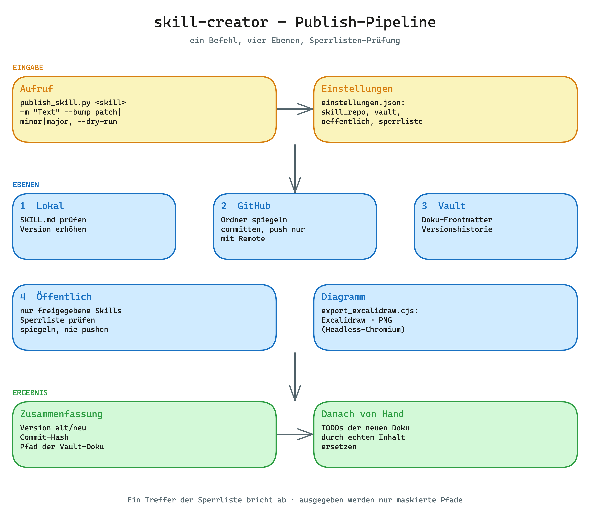

# skill-creator - Publish-Pipeline fuer Claude-Skills

Wer Skills pflegt, macht nach jeder Aenderung dieselben Schritte von Hand: Version erhoehen, ins Repo kopieren, committen, die Doku fortschreiben, bei oeffentlichen Skills die Sperrliste pruefen. `skill-creator` buendelt das in einem Befehl, `publish_skill.py` (nur Python-Standardbibliothek), und rendert dazu Excalidraw-Diagramme als PNG. Pfade und Namen stehen nicht im Code, sondern in einer Einstellungsdatei.



> Quelle des Diagramms: [`skill-creator-overview.excalidraw`](skill-creator-overview.excalidraw)

## Installation

```bash
git clone https://github.com/nyko073006/how-i-learned-claude.git
mkdir -p ~/.claude/skills
test -e ~/.claude/skills/skill-creator && echo "skill-creator existiert schon, nichts kopiert" || cp -R how-i-learned-claude/skills/skill-creator ~/.claude/skills/
```

Die letzte Zeile kopiert nur, wenn es `~/.claude/skills/skill-creator` noch nicht gibt; ein vorhandener Skill gleichen Namens wird nie ueberschrieben.

`skill-creator` heisst wie Anthropics offizieller Skill. Meldet die Zeile einen vorhandenen Ordner, nicht darueberkopieren: entweder auf diesen Skill verzichten oder den vorhandenen Ordner vorher selbst umbenennen. Dieser Skill erwartet sich unter `~/.claude/skills/skill-creator`, seine Befehle nennen diesen Pfad.

Voraussetzungen: Python 3 und Git. Fuer die PNG-Diagramme zusaetzlich Node, Playwright mit Chromium (`npm i -g playwright && npx playwright install chromium`) und Netz zu `cdn.jsdelivr.net`.

Einstellungen stehen in `~/.config/claude-skills/einstellungen.json` (Pfad per Env `CLAUDE_SKILLS_EINSTELLUNGEN` ueberschreibbar). Eine Vorlage liegt im Repo unter `skills/einstellungen.beispiel.json`:

```bash
mkdir -p ~/.config/claude-skills
cp -n how-i-learned-claude/skills/einstellungen.beispiel.json ~/.config/claude-skills/einstellungen.json
```

`cp -n` laesst eine vorhandene Datei unberuehrt. In der Vorlage sind die meisten Werte leer (`""` oder `[]`), vorbelegt sind nur `repo_wurzeln` und `sperrliste`; ein leerer Wert wirkt wie ein fehlender (Ausnahme `repo_wurzeln`: eine leere Liste `[]` ist ein Fehler, der Schluessel darf aber fehlen). Danach eigene Werte eintragen: `skill_repo` (Pfad des privaten Skill-Repos, Pflicht), `vault` (eigener Vault-Pfad), bei Bedarf `skill_remote`, `oeffentlich`, `oeffentlich_repo` und `sperrliste` (Tabelle unten).

| Schluessel | Bedeutung |
|------------|-----------|
| `skill_repo` | Pflicht (oder `--repo-dir`). Privates Skill-Repo, Ziel von Ebene 2. |
| `skill_remote` | GitHub-Slug `besitzer/repo`, fuer Hinweise und `--create-remote`. |
| `vault` | Vault-Wurzel fuer Ebene 3. Fehlt er, gibt es eine Warnung und keinen Doku-Schritt. |
| `oeffentlich` | Liste der Skills, die zusaetzlich oeffentlich gespiegelt werden. |
| `oeffentlich_repo` | Lokale Arbeitskopie des oeffentlichen Repos. |
| `sperrliste` | Datei mit Sperrbegriffen, ein Begriff je Zeile, `#` Kommentar, `!` vorn eine Ausnahme (nur mit Wortgrenze). Vorgabe: `~/.config/cockpit/public-denylist.txt`; fehlt auch diese Datei oder ist sie leer, endet das Skript mit Exit 2. |

## Nutzung

Nach jeder Skill-Erstellung oder -Aenderung:

```bash
python3 ~/.claude/skills/skill-creator/scripts/publish_skill.py <skill-name> -m "Was wurde geaendert"
```

Ausloeser im Chat: `publish skill`, `skill veroeffentlichen`, `skill releasen`, `skill dokumentieren`, `version bumpen`, `publish_skill`.

Weitere Beispiele:

```bash
python3 ~/.claude/skills/skill-creator/scripts/publish_skill.py lint -m "Projekt-Compliance-Check ergaenzt"
python3 ~/.claude/skills/skill-creator/scripts/publish_skill.py meinskill -m "Erstveroeffentlichung" --no-version-bump
python3 ~/.claude/skills/skill-creator/scripts/publish_skill.py meinskill -m "Neue Funktion" --bump minor --dry-run
python3 ~/.claude/skills/skill-creator/scripts/publish_skill.py --pruefe-oeffentlich
```

## Die vier Ebenen

| Ebene | Was passiert | Ort |
|-------|--------------|-----|
| 1. Lokal | `SKILL.md` validieren, SemVer-Version lesen und erhoehen | `~/.claude/skills/<name>/` |
| 2. GitHub | Skill-Ordner ins Repo spiegeln, committen, pushen (nur mit Remote `origin`) | `<skill_repo>/<name>/` |
| 3. Vault | Doku-Frontmatter und Versionshistorie fortschreiben | `<vault>/03 Bereiche/Skills/<name>.md` |
| 4. Oeffentlich | nur Skills in `oeffentlich`: Sperrliste pruefen, spiegeln, committen, nie pushen | `<oeffentlich_repo>/skills/<name>/` |

## Flags

| Flag | Bedeutung |
|------|-----------|
| `<skill-name>` | Pflicht. Ordnername unter `~/.claude/skills/`. |
| `-m`, `--message` | Pflicht. Commit-Nachricht und Zeile der Versionshistorie. |
| `--bump patch\|minor\|major` | SemVer-Sprung, Vorgabe `patch`. |
| `--no-version-bump` | Version bleibt, fuer die Erstveroeffentlichung. |
| `--dry-run` | Zeigt alle geplanten Aenderungen, schreibt nichts. |
| `--create-remote` | Legt das GitHub-Repo per `gh repo create` an. Vorgabe aus, nur mit ausdruecklicher Zustimmung. Ohne `skill_remote` und ohne `origin` Exit 2 vor jedem Schreiben. |
| `--pruefe-oeffentlich` | Ohne Skill und `-m`: prueft alle Dateien unter `<oeffentlich_repo>/skills/` gegen die Sperrliste und meldet verwaiste Ordner; dazu die noch nicht gepushten Commits (`@{u}..HEAD`: Ordner, geaenderte Dateien unter `skills/`, Commit-Nachrichten). Ohne Upstream nur der Arbeitsbaum, mit Hinweis. Exit 0 sauber, 2 bei Treffern oder fehlender Einstellung oder fehlendem `skills/` (ohne Ausnahme, auch im Repo ohne Commit; die Erstlauf-Ausnahme gilt nur im Normallauf beim allerersten Lauf). |
| `--skills-dir`, `--repo-dir`, `--vault-dir` | Pfade ueberschreiben. |

## Sperrlisten-Pruefung

Verglichen wird in Normalform (NFKD, ohne Akzente und unsichtbare Formatzeichen, klein); Treffer zaehlen auch im Dateipfad und im Binaerinhalt (z. B. Text-Chunks eines PNG); gerenderte Schrift im Bild sieht die Pruefung nicht. Ein PNG gilt nur als geprueft, wenn es aus der geprueften `.excalidraw` neu gerendert ist. Ausgegeben werden nur der Pfad (Treffer als `***` maskiert) und die Zeile, nie der Treffertext. Nutzerpfade und Links auf Claude-Sitzungen sind immer gesperrt, Symlinks gelten immer als Treffer. Eine `.publicignore` im Skill-Ordner (ein Glob je Zeile, `ordner/` fuer ganze Ordner) nimmt Dateien vom oeffentlichen Spiegel aus; sie selbst wird nie gespiegelt. Geprueft wird vor dem Kopieren und noch einmal am Index vor dem Commit; ein Treffer bricht ab. Ist das Spiegelziel, ein Elternordner bis zum Repo oder ein Eintrag darin ein Symlink, bricht der Lauf vor jedem Schreiben ab, auch vor dem Versionssprung; Inhalte von `venv/` und `node_modules/` prueft er nicht, weil der Spiegel dort nichts schreibt.

## Vault-Doku

Die Dateien in `03 Bereiche/Skills/` sind handgeschrieben. Existiert die Doku, aendert das Skript genau zwei Dinge: `version:` und `aktualisiert:` im Frontmatter sowie eine neue Zeile in der Tabelle "Versionshistorie". Existiert sie nicht, legt das Skript sie mit Ueberblick, Trigger, Funktionsumfang, Nutzungsbeispielen, Voraussetzungen, Dateistruktur, Verwandt und Versionshistorie an; offene Stellen stehen als sichtbares `TODO` darin und muessen danach von Hand durch Inhalt ersetzt werden.

## Diagramm als PNG

```bash
node ~/.claude/skills/skill-creator/scripts/export_excalidraw.cjs ~/.claude/skills/<skill>/<skill>-overview.excalidraw
node ~/.claude/skills/skill-creator/scripts/export_excalidraw.cjs quelle.excalidraw ziel.png --scale 2
```

Das PNG entsteht mit der Exportfunktion von `@excalidraw/utils` (Version 0.1.5) in Headless-Chromium; die Vorgabe `--scale 4` ergibt rund 4.000 Pixel Breite. Vor `publish_skill.py` ausfuehren, damit das PNG mitgespiegelt wird, und das Ergebnis ansehen.

## Tests

```bash
cd ~/.claude/skills/skill-creator/scripts && python3 -m unittest test_publish_skill -v
```

## Hintergrund

Der Spiegel schliesst `.git/`, `venv/`, `node_modules/`, `__pycache__/`, `.DS_Store`, `*.pyc`, `*.log` und `.env*` aus; ohne diese Ausschluesse zoegen einzelne Skills ueber 27.000 Dateien ins Repo, und `.env`-Dateien waeren ein Secret-Leck. Ein Repo auf GitHub legt das Skript nie von selbst an, und das oeffentliche Repo wird nie gepusht: Das bleibt eine bewusste Handlung.

## Quellen

Es gibt keine inhaltlichen Vorlagen von Dritten; Ablauf und Regeln sind eigenstaendig. Fuer das PNG-Rendern nutzt `export_excalidraw.cjs` zur Laufzeit zwei fremde Werkzeuge, ohne sie mitzuliefern: [`@excalidraw/utils`](https://github.com/excalidraw/excalidraw) 0.1.5 (Exportfunktion, per CDN geladen) und [Playwright](https://playwright.dev) mit Chromium.

## Dateistruktur

```
skill-creator/
├── SKILL.md                           <- Skill-Logik (Lifecycle, Flags, Ablauf)
├── README.md                          <- Diese Datei
├── LICENSE
├── skill-creator-overview.excalidraw  <- Ablauf-Diagramm (Excalidraw-Quelle)
├── skill-creator-overview.png         <- Ablauf-Diagramm (gerendert)
└── scripts/
    ├── publish_skill.py               <- Publish-Pipeline
    ├── test_publish_skill.py          <- Tests
    └── export_excalidraw.cjs          <- Excalidraw nach PNG
```

## Lizenz

MIT, siehe [LICENSE](LICENSE).
