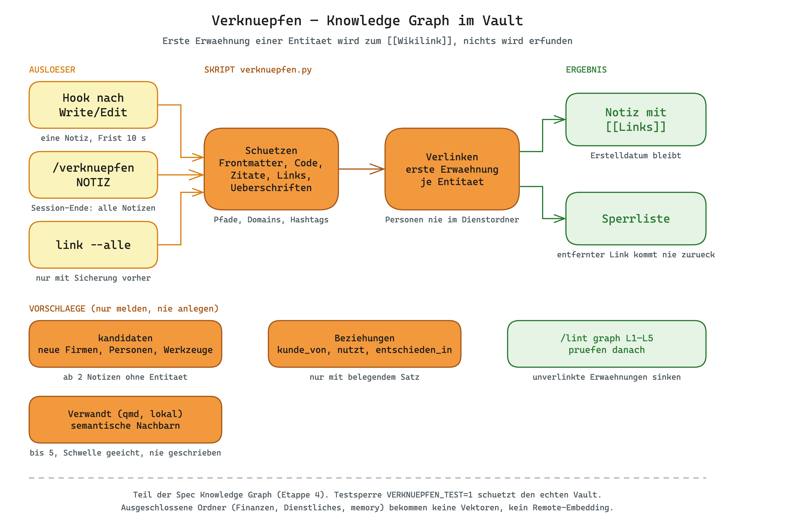

# Verknuepfen Skill - Knowledge Graph im Vault

Verlinkt Notizen in einem Obsidian-Vault mit den Entitaeten (Personen, Firmen, Werkzeuge, Projekte) und schlaegt
neue Entitaeten und Beziehungen vor. Problem: Erwaehnungen blieben Fliesstext, der Graph hatte Luecken, und der alte
Hook verlinkte zu grob (Codeblocks, Zitate, Tabellen). Der Skill setzt Links im Notiztext regelbasiert per Skript, nie von Hand.



## Installation

Wie im Abschnitt "Skills" des Haupt-README von [how-i-learned-claude](https://github.com/nyko073006/how-i-learned-claude#installation) beschrieben; einen vorhandenen Ordner nicht ueberschreiben:

```bash
git clone https://github.com/nyko073006/how-i-learned-claude.git
mkdir -p ~/.claude/skills
test -e ~/.claude/skills/verknuepfen && echo "verknuepfen existiert schon, nichts kopiert" || cp -R how-i-learned-claude/skills/verknuepfen ~/.claude/skills/
```

Voraussetzung: Python 3 (nur Standardbibliothek), der Skill `lint` unter `~/.claude/skills/lint` (liefert `vault_lint.py`). Optional fuer `nachbarn` und `index`: qmd und Node (siehe Schritt 4 unten); die uebrigen Befehle laufen ohne.

Vault und Dienstordner stehen in `~/.config/claude-skills/einstellungen.json` (Pfad per Env `CLAUDE_SKILLS_EINSTELLUNGEN`
ueberschreibbar), dieselbe Datei wie beim Skill `lint`:

```json
{"vault": "~/Pfad/zu/deinem/Vault", "dienst_ordner": "02 Projekte/Dienst"}
```

- `vault`: Pfad des Vaults. Ohne `--vault` und ohne diesen Schluessel brechen alle Befehle mit Klartext und Exit 2 ab.
- `dienst_ordner` (optional, Vorgabe leer): Vault-relativer Ordner fuer dienstliche Notizen. Leer heisst: keine Notiz
  gilt als dienstlich.

```bash
python3 -I -m unittest discover -s ~/.claude/skills/verknuepfen/scripts
```

Der Hook `~/.claude/hooks/auto-link-entities.py` wird **nicht mitgeliefert**: Er gehoert zur eigenen Claude-Konfiguration
des Autors und liegt nicht in diesem Ordner. Der Hook-Eintrag aus `SKILL.md` (Abschnitt Grenzen) ist ohne diese Datei
wirkungslos; die Tests in `test_hook.py` werden dann uebersprungen. Der Skill selbst (`link`, `kandidaten`, `index`,
`nachbarn`) laeuft ohne Hook.

## Nutzung

| Aufruf | Verhalten |
|--------|-----------|
| `/verknuepfen NOTIZ` | Schritte 1 bis 5 fuer eine Notiz |
| `/verknuepfen` | Notizen der laufenden Session, am Session-Ende |
| `/verknuepfen kandidaten` | Nur Schritt 2, neue Entitaeten vorschlagen |
| `/verknuepfen --alle` | Alle Quellen, nur auf Entscheidung des Nutzers, mit Sicherung vorher |

Das Skript direkt:

```bash
python3 -I ~/.claude/skills/verknuepfen/scripts/verknuepfen.py link NOTIZ [--dry-run] [--json DATEI]
python3 -I ~/.claude/skills/verknuepfen/scripts/verknuepfen.py link --alle --dry-run
python3 -I ~/.claude/skills/verknuepfen/scripts/verknuepfen.py kandidaten [--vault PFAD] [--min 2] [--notiz NOTIZ...] [--json DATEI]
python3 -I ~/.claude/skills/verknuepfen/scripts/verknuepfen.py index [--vault PFAD]
python3 -I ~/.claude/skills/verknuepfen/scripts/verknuepfen.py nachbarn [--vault PFAD] [--json DATEI] NOTIZ
```

| Option | Bedeutung |
|--------|-----------|
| `--vault PFAD` | Vorgabe: Einstellung `vault`; fehlt beides, Exit 2 mit Klartext |
| `--dry-run` | nichts schreiben (`link`) |
| `--alle` | alle Quellen (`link`) |
| `--min N` | mindestens N verschiedene Notizen (`kandidaten`, Vorgabe 2) |
| `--notiz NOTIZ...` | nur Kandidaten, die in diesen Notizen vorkommen; Zaehlung bleibt vault-weit (`kandidaten`) |
| `--json DATEI` | Ergebnis als JSON; bei `link` mit `not_written`, bei `kandidaten` mit `alle_notizen`, bei `nachbarn` mit `nachbarn` und `uebersprungen` |

## Ablauf

1. Entitaeten verlinken (`link`): erste unverlinkte Erwaehnung je Entitaet, Titel und Aliase.
2. Kandidaten (`kandidaten`): Firma (bis vier Grossbuchstaben-Woerter vor GmbH, AG, UG, KG, SE, e.V., Inc., Ltd.),
   Person (Herr, Frau, Dr., Prof. vor einem oder zwei Namen, nie unter dem Dienstordner `dienst_ordner`),
   Werkzeug (Binnenmajuskel wie GitHub, iCloud). Nur Vorschlag.
3. Beziehungen (`kunde_von`, `nutzt`, `entschieden_in` im Frontmatter der Entitaet) setzt das Modell per Edit, nur mit belegendem Satz und Fundstelle, sonst Vorschlag.
4. Semantische Nachbarn (`nachbarn`, qmd, lokal): je Notiz bis zu fuenf Zeilen `Verwandt: [[Name]] (0.xx)` oder
   `Schritt 4 übersprungen: <Grund>`, Exit 0 (Exit 1: Notiz nicht im Vault, Exit 2: Vault oder Ordner der `--json`-Datei fehlt). Nur Vorschlaege im Bericht, nie in die Notiz. Schon verlinkte Notizen, die
   Notiz selbst und ausgeschlossene Ordner fallen weg; unter `graph.schwelle` kommt nichts.
5. Bericht, eine Zeile je Aenderung und Vorschlag.

Geschuetzt (kein Link): Frontmatter, Codebloecke, eingerueckter Code, Zitate und Callouts, Inline-Code, Wikilinks,
Markdown-Links, URLs, Hashtags, Pfade, Domains, Kommentare, Ueberschriften. Tabellenzeilen nur ohne Alias-Link.
Sperrliste: Ein von Hand entfernter Link kommt nicht zurueck. Parallele Laeufe teilen sich eine Dateisperre auf der Zustandsdatei. Sie wartet hoechstens 10 Sekunden (`VERKNUEPFEN_SPERRFRIST`, Sekunden, auf 12 gekappt), danach bricht der Lauf mit "Sperre belegt" ab und die Notiz bleibt unveraendert.

## Schritt 4: semantische Nachbarn (Etappe 4)

Am Session-Ende erst `index`, dann `nachbarn` je geschriebener Notiz.

`index` schreibt `~/.config/qmd/<index>.yml` aus den Einstellungen, ruft `qmd update`, `embed` und `cleanup` und prueft
danach den Index auf ausgeschlossene Pfade und fremde Collections. Der erste Lauf dauert lange (24 Minuten fuer etwa
1.300 Notizen auf einem M-Mac), danach nur geaenderte Notizen (Sekunden). Liegt unter dem Namen schon eine fremde
qmd-Konfiguration (andere Collection, anderer `path`, eigene Schluessel wie `global_context`), bricht `index` mit Exit 1 ab
und laesst sie unveraendert; dann einen anderen `graph.qmd_index` waehlen oder die Datei selbst sichern.

Die Abfrage laeuft ueber `scripts/qmd_vektor.mjs` (qmd-SDK `store.searchVector`, nur das Modell embeddinggemma-300M,
rund 330 MB, etwa 2 s je Abfrage). `qmd vsearch` ist absichtlich nicht im Einsatz: Es laedt je Abfrage ein Modell mit
1,7 B Parametern zur Erweiterung, und sein Score ist dann kein reiner Kosinus mehr.

### Installation

```bash
npm install -g @tobilu/qmd@2.8.3
```

Voraussetzung: Python ab 3.13, Node ab 22. npm 11 sperrt Install-Skripte, qmd laeuft trotzdem. Das Modell laedt der erste
`index`-Lauf einmal herunter.

### Datenschutz

Kein Remote-Embedding. `graph.ausschluss` (Vorgabe `03 Bereiche/Finanzen/**`,
`memory/**`; den Dienstordner selbst ergaenzen, z. B. `02 Projekte/Dienst/**`) plus fest `.obsidian/**`, `.trash/**`, `07 Anhaenge/**`: Diese Ordner bekommen keine Vektoren. Eine
ausgeschlossene Ausgangsnotiz wird nicht abgefragt. Eine qmd-Konfiguration mit Fremdmodell (`http(s)` oder ein Modell, das
nicht mit `hf:` beginnt) sperrt `index` und `nachbarn`.

Offline-Beleg: Die Sandbox sperrt das Netz, der Index wird gebaut und abgefragt, ein Fremdmodell erzeugt keinen Vektor.

```bash
VERKNUEPFEN_QMD_PROBE=1 bash ~/.claude/skills/verknuepfen/scripts/offline_probe.sh
```

### Einstellungen

`~/.config/verknuepfen/einstellungen.json` (Pfad ueber `VERKNUEPFEN_EINSTELLUNGEN`), bei jedem Lauf frisch gelesen.

| Schluessel | Bedeutung | Vorgabe |
|------------|-----------|---------|
| `graph.ausschluss` | Liste von Mustern; ersetzt die Vorgabe ganz, also alle Muster eintragen | siehe Datenschutz |
| `graph.schwelle` | Mindest-Score als Zahl mit Punkt (z. B. `0.37`); `null` schaltet Schritt 4 aus | `null` |
| `graph.max_nachbarn` | hoechstens so viele Zeilen | 5 |
| `graph.qmd_index` | Name des qmd-Index | `vault` |
| `graph.qmd_frist` | Frist je Abfrage in Sekunden | 30 |

### Eichung

```bash
python3 -I ~/.claude/skills/verknuepfen/scripts/eichen.py --vault PFAD PAARLISTE.md
```

Zeilen der Paarliste: `- [[A]] | [[B]] | verwandt` oder `| nicht`. Das Skript druckt die Scores, die Schwelle und die
Trefferquote und schreibt nichts; die Schwelle traegt man selbst in `einstellungen.json` ein. Ergebnis in einem Vault mit
rund 1.300 Notizen: 0,37 bei 19 von 20 Paaren. Die Paarliste ist privat und gehoert nicht in den Skill.

Bekannte Grenze: Daily Notes und technische Pruefnotizen tauchen oft als Nachbarn auf. Die fuenf besten Treffer liegen fast
immer ueber 0,48, die Schwelle schneidet also selten etwas ab.

## Hintergrund

Teil der Etappen 3 und 4 "Knowledge Graph". Spec: `03 Bereiche/Claude Code/2026-11-15 Spec Knowledge Graph.md`, Abschnitt 4.
Grenze Dienstliches (Spec 8): Personen werden unter dem Dienstordner (`dienst_ordner`) nie verlinkt; ohne Einstellung entfaellt die Grenze.

## Quellen

- Spec Knowledge Graph (Vault), Abschnitte 4 und 8
- Skill `lint`, Regel L1 (Entitaeten, Quellen, Namensschluessel)

## Dateistruktur

```
verknuepfen/
  SKILL.md
  SKILL.en.md
  README.md
  verknuepfen-overview.excalidraw   Diagramm (Quelle)
  verknuepfen-overview.png          Diagramm
  scripts/
    verknuepfen.py      Kern, CLI link, kandidaten, index und nachbarn
    nachbarn.py         Schritt 4: Einstellungen, Index, Abfrage, Ausschluss
    qmd_vektor.mjs      reine Vektorsuche ueber das qmd-SDK
    eichen.py           Schwelle eichen (schreibt nichts)
    offline_probe.sh    Offline-Beleg (nur mit VERKNUEPFEN_QMD_PROBE=1)
    test_verknuepfen.py Tests
    test_nachbarn.py    Tests Schritt 4
    test_eichen.py      Tests der Eichung
    test_hook.py        Tests des Hooks
    testdaten/          erfundene Testvaults (link/, kandidaten/)
```

Der Hook `~/.claude/hooks/auto-link-entities.py` liegt ausserhalb und wird nicht mitgeliefert (siehe Installation).
